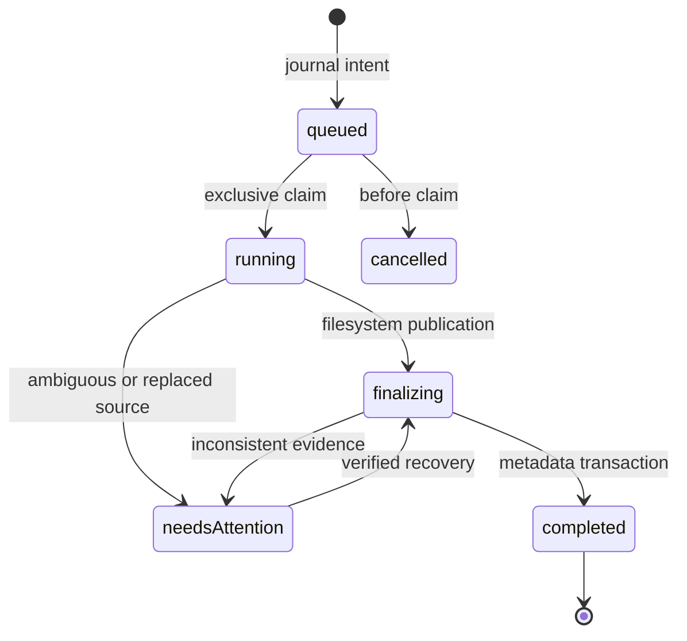

# Luma v2 implementation and recovery plan

Baseline: `0ba2838`, .NET 10 / Dapper / SQLite WAL, React 19 / TanStack Query and Virtual / Radix Dialog. One build and deployment remain mandatory. This document distinguishes planned work from shipped behavior; the master specification is the acceptance checklist, not a claim of completion.

## Source audit

| Area       | Existing implementation                                    | Reuse / required changes                                                                                                                                                                                                 |
| ---------- | ---------------------------------------------------------- | ------------------------------------------------------------------------------------------------------------------------------------------------------------------------------------------------------------------------ |
| Roots      | `IndexingOptions`, `IndexingSetup`, `Libraries`            | Stable IDs, no overlapping roots, case policy, symlink rejection. Add opt-in write configuration; configuration remains authoritative.                                                                                   |
| Paths      | `ScanWorker.SourcePaths`, `SourceTraversal`                | Checks currently require every segment to exist. Add destination validation, protected internal directories, and journal staging paths. Exclude internal paths from traversal and watcher hints.                         |
| Identity   | `Media.Id`, `FolderAncestry`, path keys                    | Existing external moves produce missing old records. App-controlled moves must update existing IDs, paths and ancestry transactionally; don't infer identity for external moves.                                         |
| Discovery  | `ScanWorker`, `DirtyFolders`, `AutomaticLibraryRefresh`    | Keep discovery out of browse requests. Coordinate mutation with scan claims; enqueue relevant discovery after publication even in manual refresh mode.                                                                   |
| Tasks      | `Scans`, `ProcessingJobs`, `MetadataJobs`, `TaskEndpoints` | Existing tasks are a projection of durable domain tables, not a generic queue. Add operation/upload projections to this same endpoint and controls; bounded domain workers are consistent with the existing design.      |
| Security   | `Program`, common `ApiRequestException`                    | No existing user authentication. File writes require the server-wide file-management switch and an explicitly writable root; reject cross-origin writes. This is a single-user application without token authentication. |
| Shell      | `app/App.tsx`, `BottomNavigation`, `BackgroundJobsButton`  | Existing URL/history and PWA restoration live in App. Preserve them, introduce logo switcher and experience-local route/query memory, retain floating task indicator everywhere.                                         |
| Feed       | `browse/Reels`, `reelsSort`, `FilterForm`                  | Retain player, motion (video + GIF) behavior, and reusable query contract. Independent Flick query state supersedes the previous shared-state architectural contract.                                                    |
| Comics     | No existing subsystem                                      | Separate indexed comic tables and bounded page providers. Explicit directory classification; on-demand archive pages and cached covers; never scan archives while listing.                                               |
| Appearance | `app/themes`, `styles.css`, `ThemePicker`                  | Extend existing tokens/preferences. Reduced motion and client appearance preferences remain separate from server write authority.                                                                                        |

## Incremental delivery

1. Commit this audit, architecture contract update and migration plan.
2. Write foundation: configuration, authentication boundary, normalized paths, internal-directory exclusions, migration/journal schema, coordination and deterministic failure tests.
3. Mutations: create, rename/move, recycle/restore, staged permanent delete, retained metadata and task projection. Add Gallery controls only after safety tests pass.
4. Uploads: protocol evaluation, durable offset sessions, bounded streaming, authoritative offset, retry, safe journaled publication, folder queue and file reselection after refresh.
5. Shell: logo app switcher, independent URL filters, legacy URL compatibility, immersive Flick, global tasks; lazy Panels route.
6. Comics: bounded ZIP/RAR inspection, explicit folder registration, indexed cover/library metadata and on-demand pages, reader progress/time, recovery and resource tests.
7. Appearance, documentation and full regression/performance verification. Keep the release version unchanged until acceptance criteria pass.

Each coherent increment is committed and pushed immediately to the implementation branch. No force push, automatic merge or release deployment.

## Mutation state and failure recovery

Journal intent must be committed with SQLite FULL synchronization before changing originals. A single mutation coordinator serializes overlapping writes in the first implementation (simple and bounded); uploads don't hold it while waiting for client bytes. No SQLite transaction spans long filesystem work. Source fingerprints plus operation-owned staging identities distinguish a replacement from the intended source. If both source and destination exist or neither can be verified, stop for attention; never guess or erase an unverified replacement. Running work is reconciled before new writes are accepted after restart. Root unavailability suspends recovery and never means deletion.

Recycle uses `.luma-trash/<operation-id>/content` on the source root to avoid cross-device copies. Retain original path, root identity and media/folder relationships. Restore rejects collisions by default and accepts an explicit alternative destination. Permanent deletion first reserves the intended source with a same-root rename into operation-owned staging; retries delete only that private staging, not a public pathname that another process could reuse. Cross-library/cross-device moves initially fail explicitly; a later copy-to-private-destination + verification + publication stage must pass fault tests before support is advertised. A recycle bin is not a backup.

Filesystem API checks cannot eliminate races with a hostile process that can replace ancestors between validation and rename. Deployment assumes trusted local writers; operations still revalidate immediately before mutation and reject symlinks. Document this boundary rather than claiming race-free filesystem confinement.

Index/database reconciliation uses existing integer IDs. Store original paths separately from recycled storage, mark recycled media unavailable, and keep retained tags/preferences/covers/progress. Exclude recycled folders without discarding user-hidden flags. Controlled moves update descendant paths and folder ancestry in one transaction, then schedule existing discovery. Scan and mutation claims must exclude each other; watcher events affecting internal paths are ignored.

Required fault tests: before journal, after journal, after reservation, after publication, before metadata commit, after metadata commit. Also collisions, source replacement, missing volume, nested symlink, recursive partial delete, restart, overlapping mutation/scan and metadata preservation. Browsing stays SQLite/cache-only.

## Upload protocol decision to validate

Compare tusdotnet/tus-js-client with a small offset protocol before implementation. tus is interoperable but introduces dependencies and integration work. A custom protocol must use durable ID, expected length, root/path, committed offset and lifecycle; strict offsets prevent duplicate/reordered chunk writes. Persist offset only after flushing bytes, truncate uncommitted tails on recovery, limit chunk length and session/staging quotas. Finalization uses the mutation journal and never overwrites implicitly. Pause/waiting-client sessions occupy no worker. Browser refresh recovery requires file reselection unless file handles remain authorized. Failure tests must cover duplicate chunks, dropped responses, disk full, restart and publication interruption. Do not claim tus compliance for a custom protocol.

## Comics and reader

Research Stump's public architecture for ideas, without importing code/assets or license assumptions. Comic library listing and search read indexed SQLite metadata. ZIP/RAR page access enumerates bounded entries, filters image formats and naturally orders names. Reject encrypted/unsupported archives, unsafe names, entry/decompression limits and oversized images. Limit concurrent extraction and output bytes; never extract the complete archive to start reading. Explicit image-folder classification avoids turning photo libraries into comics.

Progress stores current page, state, last-read time and reader preferences by comic ID. Reading-time heartbeats use session/sequence deduplication and bounded active intervals, paused on hidden tabs or inactivity. Continuous reading uses virtualization and bounded adjacent-page prefetch; release offscreen images. Test page ordering, corrupt/bomb archives, direction/navigation, persistence, duplicate heartbeats, reader visibility and large libraries.

## Migration and validation

Existing installations and Docker mounts stay read-only by default. Add append-only numbered SQL migrations; never edit shipped checksums. Configuration is authoritative for writable roots and access secrets; expose capabilities, never the secret, in ordinary library responses. Use generated OpenAPI TypeScript contracts. Preserve old query/deep links and PWA restoration. Update versioned schema assertions deliberately.

Required commands: backend build and tests, frontend build/tests/lint, generated-contract consistency and targeted browser tests. Establish baseline failures before changing code. Run indexing/browse performance tools on equivalent fixtures and distinguish measured results from expectations. Release remains blocked until filesystem recovery, upload recovery and comic resource limits are verified.

## Implemented increments

- Mutation capability boundary: opt-in `LibraryOptions.Writable`, `Luma:Files:Enabled`, a persisted Settings switch, and same-origin browser checks. Browsing is unchanged. Flick, Panels and comic metadata are independent of file management. Old access tokens are ignored.
- Public relative paths reject traversal, internal staging, symlinks (including dangling links), Windows reserved names and excessive depth. Index traversal/watchers exclude staging at any nesting level.
- First mutation implementation deliberately serializes each library and rejects an enqueue during indexing or unresolved work. Same-library moves only; no implicit overwrite or automatic recovery that guesses a public source's identity. `needsAttention` blocks further writes/indexing for that root until the user resolves the evidence. Automatic retention cleanup, cross-device moves and bulk batches are not yet implemented.

### Upload protocol implemented

The [tusdotnet README](https://github.com/tusdotnet/tusdotnet/blob/master/README.md) was reviewed: it provides disk storage, protocol extensions and completion hooks, but its store lifecycle would still need integration with Luma's SQLite operation journal and root reservations. The initial implementation uses a smaller **custom, non-tus** offset protocol: POST session, GET durable offset, PATCH bytes with offset and Content-Length, POST pause/resume/cancel/finalize. Maximum chunk 8 MiB, copy buffer 64 KiB, 1–4 transfers (default 2), fixed 32 lock stripes, maximum 128 active sessions. Server settings `Luma:Uploads:MaxFileBytes`, `StagingQuotaBytes`, `Concurrency` bound admission; defaults reserve up to 1 TiB across sessions. This quota is admission accounting, not a free-disk guarantee. Disk errors remain visible and do not publish partial files.

Chunks flush to disk before a FULL-synchronous offset checkpoint. A failed transfer may leave an uncommitted tail; the next request truncates it to the server checkpoint. Retrying a committed offset returns a conflict, so the client fetches the authoritative offset. Upload sessions waiting for bytes do not occupy workers; the first version conservatively reserves the entire library against mutations. Staging lives on the destination root. Finalization enqueues a journaled operation, uses a no-overwrite rename, updates session completion and schedules the existing shallow scan even in manual refresh mode.

Browser controls appear in Gallery's folder toolbar. Settings persists the file-management toggle for this server. Upload workers survive sub-app switches; localStorage records session IDs/targets/size/mtime, never file bytes. Refresh requires reselecting original files. Native folder selection preserves paths; drop currently accepts files only. Folder hierarchy is created through the operation journal before transfers begin. Conflicts are explicit; automatic replace, drag-and-drop directory traversal and adaptive concurrency remain unimplemented.

### Panels backend implemented

[Stump's public README](https://github.com/stumpapp/stump/blob/main/README.md) informed the separation of comic library metadata and readers; no Stump code or assets were imported. [SharpCompress](https://github.com/adamhathcock/sharpcompress) supplies ZIP/RAR parsing under its MIT license. Discovery is a durable `ComicJobs` domain task in the shared task projection, using existing configured roots and path checks. Archive discovery is explicit; image folders require explicit registration. Normal comic listing and cover access read SQLite/generated cache and never inspect originals.

Comic sources expose the same indexed page abstraction for ZIP/CBZ, non-solid RAR/CBR and direct image folders. Inspection is bounded to 5,000 entries, 64 MiB per page and 4 GiB declared image expansion. It rejects encryption, traversal, duplicate page names and unsupported archives. Solid RAR is explicitly unsupported because random access may decompress all preceding entries. Archive inspection/extraction runs in isolated child processes with a 30-second deadline, 256 MiB managed heap and bounded tool output. Child process limits do not claim a kernel-enforced bound on all unmanaged memory. Generated previews and covers reuse the existing decoder pool and aggregate processing slots.

Comic generated cache has a separate bounded 512 MiB LRU budget; it is disposable. Reader page access is on demand, with optional original resolution; cover generation is background discovery work. Metadata supports title, series, author, description, favourite and cover-page selection. Reading progress/time are persisted by comic ID. Session+sequence checkpoints deduplicate heartbeats; accepted active time is bounded by 30 seconds and server elapsed time. Classification/moves/recycle/restore retain comic identity and reading progress through journal snapshots. External source changes require rediscovery; folder-page-content changes without a directory timestamp change are not automatically detected. Full archive metadata extraction, PDF reading and external metadata providers are not implemented.

### Application shell and first Panels reader

The logo opens the accessible application switcher. Gallery retains Library/Search/Collections; Flick and Panels hide Gallery navigation. Flick has an always-visible top switcher/search/settings header, including empty/error feeds. Existing `?view=reels` links remain accepted; canonical routes are `/gallery`, `/flick` and `/panels`. Gallery/Flick filters and Panels queries persist independently. Panels reader links preserve the comic ID through refresh. Flick and Panels load as separate frontend chunks within the same deployment. Global tasks remain available across experiences.

The first Panels UI provides indexed search/status/series filtering, bounded 60-item result pages, explicit archive/folder discovery and single/virtualized continuous reading. Reader controls include direction, fit, zoom/pan, fullscreen and page selection; bounded adjacent-page prefetch never loads every page. Saved fit/mode/direction and page resume from SQLite. Progress changes flush immediately; in-flight requests drain a queued final checkpoint, retry the exact session/sequence after a dropped response, and use keepalive for page exit. Visibility/inactivity bound client reading time. Metadata editing and richer collections/statistics UI remain pending.

Validation for the recovered Panels increment: backend build succeeds; all 175 backend tests pass with `xUnit.MaxParallelThreads=1`. A concurrent run passed 173/175 with existing latency checks failing under load; the nine related timing tests also pass in isolation. Frontend build/lint and 148 tests pass. Browser scenarios are updated, but browser execution is pending because the advertised Playwright Chromium download returned HTML rather than a ZIP archive. Existing ImageSharp package vulnerability advisories are emitted during restore; the dependency upgrade remains a separate stabilization task.

### Upload recovery hardening

Session creation accepts an optional client-generated request ID. The browser saves it before sending POST, so a lost response can be retried after refresh without orphaning a second session. Reusing an ID for different root/path/length is rejected. Active target reservations apply the root's case policy. Cancellation releases the durable reservation only after staging deletion succeeds; retrying a completed cancellation is idempotent. Browser cancellation errors stay visible and persisted, and resuming finalization queries server state without an invalid resume command. Folder creation accepts only an explicit existing-directory result and bounds retries for library-busy scans; a file collision remains an error. Targeted tests cover lost creation responses, refresh/reselection, duplicate creation, case collisions, deletion failures and finalization resume.

### Explicit file-operation recovery

Migration 0030 retains the last durable phase when an operation needs attention. Protected recovery endpoints and the task dialog show source/staging/destination evidence. Operators can retry a supported checkpoint, select an unused alternative before publication, explicitly confirm a destination matching recorded evidence, cancel an unreserved operation, or renew intent for a current source matching its fingerprint. Requests revalidate evidence inside the journal transaction and reject unsupported actions. Recovery requests are durable across queue claim/restart; retries never overwrite a public collision. An unavailable root, symlink or filesystem access failure does not release the root reservation. Size/time/type are evidence, not a content identity guarantee; explicit confirmation is required for ambiguous publication. Unsupported evidence remains blocked for filesystem inspection rather than offering a force-complete action. Unresolved operations take priority over historical rows in the bounded task projection.

The idle comic worker no longer takes SQLite's write lock without queued discovery. Page records use one bounded bulk insert, and discovery yields to foreground writes. The concurrent local run after this fix passed the like-latency check and 179/180 tests; an existing cold `/api/status` logging-threshold check remained timing-sensitive under concurrent load.

Recovery validation: 21 targeted backend checks passed, followed by all 13 file-operation tests after adding a changed-destination rejection. All 153 frontend tests pass with two workers; the eight task/recovery UI checks pass after the final accessibility change. The complete serialized backend run passed 183/184; its remaining failure was the existing request-overlap logging assertion, which did not observe overlap. These timing-sensitive failures are not counted as passing release criteria. Browser execution, performance characterization and stabilization remain open.

### Device appearance and app identity

Three original palettes (Sakura dusk, Celestial and Manga paper) extend the shared theme tokens and generated PWA manifests. Appearance settings support built-in atmospheric/paper backgrounds, solid colors, gradients and a custom raster image, plus blur/opacity/darkness/position/scaling. A theme-colored wash keeps content readable. Custom images stay in browser IndexedDB, independently of server write authority; object URLs are released on replacement/unmount. Input is limited to 8 MiB JPEG/PNG/still WebP, with bounded header inspection before decoding (16 megapixels, 8,192 pixels per side, 4,096 header segments/chunks). Saved rasters have a maximum 2,048-pixel edge. Browser decoders are not a kernel-enforced memory sandbox.

Motion follows the OS by default, with reduced/off overrides. Atmospheric motion only animates transforms and only runs when the device and preference allow it. App introductions are nonblocking, dismissible, 900 ms and once per sub-app per tab session; reduced motion skips them. New palette tests check normal text, secondary text and accent-control contrast. Browser-native image/storage integration still needs browser verification; local Playwright installation remains blocked by invalid download responses.

### Stabilization after appearance

Appearance build, lint, formatting and all 166 frontend tests passed locally. The recovery Linux CI run passed backend formatting/build/tests and generated-contract checks; a following small commit fixed formatting in its new UI test. Subsequent CI still intermittently exceeded the unchanged one-second like-latency assertion while unrelated archive tests were running.

HTTP timing tests now run in a collection isolated from other test collections. The overlap-logging test deliberately holds handlers after arrival, checks all eight arrival counts, then verifies counters return to one. Background SQLite batches yield before checking foreground priority. Matrix jobs complete independently so a Linux failure cannot cancel Windows evidence. Assertions and latency thresholds remain unchanged. The local executor disconnected during this validation run; the new stabilization changes must be validated by CI, and no interrupted run is counted as passed.

A 100,000-row baseline SQL smoke fixture ran, but the executor disconnected before a comparable candidate run and raw reports could be preserved. No before/after benchmark conclusion is claimed. Remaining release work includes recycle policy/retention and richer bulk operations, browser-native background verification, complete browser regression, comic-library editing/collections polish, documentation and performance acceptance on target hardware.

### Browser regression follow-up

CI for `50e3a1b` passed backend formatting/build/tests on Linux and Windows, generated-contract checks, and frontend formatting/lint/build/all 166 unit tests on both platforms. Windows finished successfully. Linux reached the browser suite: 6 passed, 2 skipped and 62 failed, with many failures blocked by the first-visit release-notes dialog. Ordinary browser scenarios now start with only the current release marked seen; a separate fresh-storage scenario checks first-visit dismissal and reload. CI retains browser failure traces for seven days. Local frontend build and all 166 unit tests pass; full browser execution remains pending.

Panels now exposes the existing indexed favourites filter. Series-only and favourites-only deep links take precedence over a previous saved query, and changing filters resets cursor pagination. Three frontend regression tests cover URL precedence, persistence and pagination reset. Frontend build and all 169 unit tests pass locally.

Deployment guidance now covers explicit writable-mount/settings opt-in, bounded upload configuration, proxy headers/chunk limits, persistent file-management enablement, interrupted-operation recovery, and consistent backups of both SQLite and media-volume staging/trash. It distinguishes current manual purge from the still-pending automatic retention feature. Configuration names and limits were checked against server code; Docker is unavailable locally, so the Compose override has not been executed here. The restored local .NET SDK completed a Release solution build and all 184 backend tests successfully.

### Comic details editing

Panels cards now open a Radix-based details dialog for title, series, author, description, favourites and a bounded numeric cover-page selector. Saving uses the existing protected metadata endpoint and refreshes indexed listings/task summaries. The summary API exposes the stored cover page so an unrelated metadata edit preserves a non-first cover. Editing fetches current metadata on opening and keeps the draft through authorization failures; focus changes do not replace it. The reusable textarea uses shared design tokens. Generated OpenAPI/TypeScript contracts include the additive field, and the database-only listing test checks cover-page metadata with the source volume unavailable.

Frontend build/lint/format and all 172 tests pass. Release backend build succeeds; the full test run encountered the existing cold-request logging threshold flake, which is tracked separately rather than counted as a passing result. The affected comic tests pass in isolation. Browser execution and target-hardware acceptance remain open.

Logging threshold tests now use an internal TimeProvider seam instead of a cold HTTP request's wall time. They cover 499/500/501 ms at the unchanged 500 ms default, disabled thresholds, route-pattern redaction and deliberately overlapping arrivals. Production uses TimeProvider.System's monotonic timestamps. All eight logging checks and the complete 187-test backend suite pass locally after this change; Release build and whitespace verification pass.

The first browser follow-up improved CI from 6 to 40 passing scenarios (29 failed, 3 skipped), and both new first-visit tests and app-switching scenarios pass. Remaining traces show empty seeded folder results, missing SQLite fixture functions, shared preference state and playback/layout assertions; these remain open regression work. Windows CI continues to pass. Failure artifacts are retained for diagnosis; no complete browser-suite pass is claimed.

Synthetic browser fixtures now explicitly use manual refresh with refresh-on-open disabled. Their cached media records intentionally have no originals, so automatic refresh was marking them missing after the first folder open. Fixture SQL connections register all five server trigger functions, including folder name/sort keys. Validation: Release Tools build and 20-item seed succeeded; a real HTTP server retained all 18 direct-root items through two folder-open requests (both 204). Direct Node SQLite folder insertion populated its name/natural-sort keys successfully. Browser test discovery, lint and formatting pass; the full browser rerun remains pending.

### Writable mount diagnostics

File management now explains the :ro → :rw mount change required by existing Docker installations. When file management is enabled, an explicit storage diagnostic checks each opted-in writable root with a tiny, removed probe in the excluded operation staging area. A failed probe reports mount/permission/free-space guidance without blocking browsing/playback or revoking the tab token. Configured read-only roots are reported without filesystem access. Rechecking is available after configuration changes. The 2.0 in-app guide documents the diagnostic. Four backend checks, including Linux's read-only /sys mount, and five access/help UI checks pass; frontend build succeeds.

### Opt-in SRT caption backend

Migration 0031 tracks disposable caption manifests/raw SRT/converted WebVTT in the configured cache directory. Explicit caption discovery supports matching same-folder sidecars and embedded SubRip only; it is not called by indexing, media browse, detail or original streaming. Only the selected track is extracted. Source identity changes invalidate selection/cache keys. Plain conversion discards source formatting, escapes markup, preserves cue timing/multiline text and rejects malformed/oversize input. FFmpeg uses explicit stream maps/container demuxers, file-only protocol access, shared processing slots, bounded output/allocation options and cancellation/deadlines. Preparation is serialized, with separate 128 MiB/512-entry LRU storage. Raw SRT survives conversion and can rebuild a missing VTT without extraction. The generated-cache sweeper retains both registered raw and converted assets.

Eight targeted backend tests pass, including real FFmpeg mixed SRT/ASS fixtures, no caption assets before explicit discovery, style removal, conversion and raw-cache reuse with unavailable tools, changed sidecars, source-link rejection and unchanged original-directory contents. API documentation and generated contracts describe the opt-in endpoints; player controls/user-guide integration follows in the next increment.

### CC controls and the 2.0 guide

The viewer and Flick now provide an explicit CC toggle, caption-track settings, loading/empty/failure feedback and native browser subtitle tracks. CC starts off for each video visit; no caption request or retained query is created for skipped Flick items. Turning it off aborts pending discovery and removes the text track. Track load/error handlers use native listeners, and cues use plain browser styling above the playback bar. Caption settings can portal inside element fullscreen. Narrow layouts place the CC controls above the playback bar to preserve its existing seek/volume layout. Caption errors do not change playback position.

The in-app 2.0 guide now explains Gallery/Flick/Panels navigation, file management, uploads, recovery and the read-only mount warning. Its caption entries prominently document SRT-only matching, actual embedded SubRip codec support, unsupported styled/image/other subtitle formats, discarded author formatting, encodings/limits, opt-in processing and cache-only generated files. Deployment and cache guides carry the same policy. Development/preview proxy configuration explicitly preserves Host so same-origin caption/file-management requests pass the API's origin checks. Caption work is mapped outside foreground-write retry/priority handling so extraction does not pause indexing.

Validation: Release solution build and all 199 backend tests pass; frontend build/lint/format and all 180 frontend tests pass. Real HTTP through Vite preview verifies same-origin caption discovery, plain cached WebVTT, cross-origin rejection and caption access without writable-library configuration. Targeted player tests verify no request until CC, off/cancellation, track selection, missing/load-failed captions, fullscreen settings and bounded Flick state. Desktop/mobile Playwright coverage for native cue loading and cache-only output is added; local browser execution remains blocked by the previously observed invalid Chromium download. Full browser regression and real-device native fullscreen/Pi acceptance remain pending.

### Disable writes after failed mount checks

Configured read-only libraries expose disabled file controls with a Settings explanation. The explicit administrator mount diagnostic also updates per-library write availability in memory: a failed check disables file controls and recovery mutations, and rejects new operations and upload writes with `media_not_writable` before source or journal changes. Capability reads remain source-filesystem-free. Check media mounts restores capabilities after a successful probe. Availability defaults to configured writability until the first check for existing API clients; the browser unlock flow performs that check. Status resets on restart. A later mount failure still uses existing durable recovery handling. Existing operations, reservations and recovery evidence are preserved; browsing, playback, opt-in captions and database tag editing remain available. Upload chunk/finalization retries stop immediately on known read-only errors.

The 2.0 user guide and deployment/API documentation explain disabled actions and rechecking. Regression tests cover per-library blocking before source/journal access, restoration, configured read-only protection, disabled UI/recovery actions and stopping upload retries. Caption test fixtures now satisfy the generated media contract and use supported exact role-name matching. Release solution build and all 201 backend tests pass; frontend production build, lint and formatting pass.

All 183 frontend tests pass with `npm test -- --maxWorkers=2`. An earlier full run alongside a build hit two Help-test timeouts; limiting concurrency resolves those without test or product changes. Targeted file-access/toolbar/recovery/caption and upload-retry checks pass. Commands: `dotnet build Luma.slnx -c Release --no-restore -m:1 -p:UseSharedCompilation=false`, `dotnet test Luma.slnx -c Release --no-build -m:1`, `npm run build`, `npm test -- --maxWorkers=2`, `npm run lint`, `npm run format:check`. Existing ImageSharp advisory/nullable and Vite bundle/config warnings remain.

### CI verification follow-up

The four checks on 8daa276 stopped at the same C# switch-arm whitespace violation, before build/tests. Commit 54425ff fixes it; both Windows jobs then completed successfully, while both Linux jobs passed backend/frontend verification and reached real browser tests (62 passed, 8 failed, 4 skipped). Browser evidence exposed an empty mobile Search field being closed by a simultaneous scope change, addressed with a regression test, and a one-pixel Settings/navigation overlap, addressed with scroll clearance. Browser playback scenarios now set their own Flick filters rather than inheriting Gallery state, and use the mobile view-options speed selector. Caption fixtures are marked missing and their owned source directory removed after each scenario, preserving scan/cache foreign keys while excluding the temporary clip from later browse queries. The complete local frontend suite passes 184 tests, with production build/lint/format checks passing. Fresh Linux/Windows CI results remain pending.

## Beta.3 comic organization

Migration 33 adds `PanelSources.ExcludeFromGallery` (default true), `ComicTags`
using the existing normalized `Tags` identities, and a discovery queue uniqueness
key per library/source. Gallery hidden-subtree predicates include excluded comic
sources without changing manually hidden folders or deleting indexed media.
Gallery scans skip these sources; existing identities and tag links survive.
XMP export uses the same visibility predicate. Gallery tag collections and
suggestions omit tags belonging only to hidden media or comics. Comic tagging
reuses the shared editor and normalization; tag rename/merge/delete includes
comic associations. Shelf folder listing reads SQLite only, with bounded pages.
Search includes series names. Discovery progress and its task button live in the
Panels header; reader preferences and page jump use the shared accessible modal.
Rollback to beta.2 or older requires its pre-migration SQLite backup.
