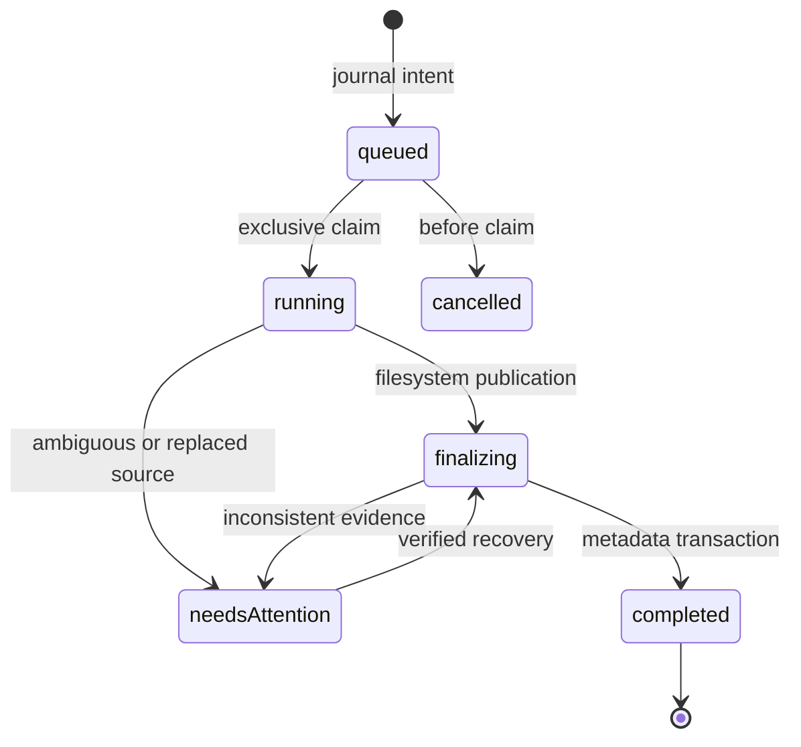

# Luma v2 implementation and recovery plan

Baseline: `0ba2838`, .NET 10 / Dapper / SQLite WAL, React 19 / TanStack Query and Virtual / Radix Dialog. One build and deployment remain mandatory. This document distinguishes planned work from shipped behavior; the master specification is the acceptance checklist, not a claim of completion.

## Source audit

| Area | Existing implementation | Reuse / required changes |
| --- | --- | --- |
| Roots | `IndexingOptions`, `IndexingSetup`, `Libraries` | Stable IDs, no overlapping roots, case policy, symlink rejection. Add opt-in write configuration; configuration remains authoritative. |
| Paths | `ScanWorker.SourcePaths`, `SourceTraversal` | Checks currently require every segment to exist. Add destination validation, protected internal directories, and journal staging paths. Exclude internal paths from traversal and watcher hints. |
| Identity | `Media.Id`, `FolderAncestry`, path keys | Existing external moves produce missing old records. App-controlled moves must update existing IDs, paths and ancestry transactionally; don't infer identity for external moves. |
| Discovery | `ScanWorker`, `DirtyFolders`, `AutomaticLibraryRefresh` | Keep discovery out of browse requests. Coordinate mutation with scan claims; enqueue relevant discovery after publication even in manual refresh mode. |
| Tasks | `Scans`, `ProcessingJobs`, `MetadataJobs`, `TaskEndpoints` | Existing tasks are a projection of durable domain tables, not a generic queue. Add operation/upload projections to this same endpoint and controls; bounded domain workers are consistent with the existing design. |
| Security | `Program`, common `ApiRequestException` | No existing user authentication. Write APIs require a server-configured mutation token plus explicitly writable root; reject cross-origin writes. Never enable anonymous destructive operations. |
| Shell | `app/App.tsx`, `BottomNavigation`, `BackgroundJobsButton` | Existing URL/history and PWA restoration live in App. Preserve them, introduce logo switcher and experience-local route/query memory, retain floating task indicator everywhere. |
| Feed | `browse/Reels`, `reelsSort`, `FilterForm` | Retain player, motion (video + GIF) behavior, and reusable query contract. Independent Flick query state supersedes the previous shared-state architectural contract. |
| Comics | No existing subsystem | Separate indexed comic tables and bounded page providers. Explicit directory classification; on-demand archive pages and cached covers; never scan archives while listing. |
| Appearance | `app/themes`, `styles.css`, `ThemePicker` | Extend existing tokens/preferences. Reduced motion and client appearance preferences remain separate from server write authority. |

## Incremental delivery

1. Commit this audit, architecture contract update and migration plan.
2. Write foundation: configuration, authentication boundary, normalized paths, internal-directory exclusions, migration/journal schema, coordination and deterministic failure tests.
3. Mutations: create, rename/move, recycle/restore, staged permanent delete, retained metadata and task projection. Add Gallery controls only after safety tests pass.
4. Uploads: protocol evaluation, durable offset sessions, bounded streaming, authoritative offset, retry, safe journaled publication, folder queue and file reselection after refresh.
5. Shell: logo app switcher, independent URL filters, legacy URL compatibility, immersive Flick, global tasks; lazy Panels route.
6. Comics: bounded ZIP/RAR inspection, explicit folder registration, indexed cover/library metadata and on-demand pages, reader progress/time, recovery and resource tests.
7. Appearance, documentation and full regression/performance verification. Keep the release version unchanged until acceptance criteria pass.

Each coherent increment is committed and pushed immediately to the implementation branch. No force push, automatic merge or release deployment.

## Mutation state and failure recovery

Journal intent must be committed with SQLite FULL synchronization before changing originals. A single mutation coordinator serializes overlapping writes in the first implementation (simple and bounded); uploads don't hold it while waiting for client bytes. No SQLite transaction spans long filesystem work. Source fingerprints plus operation-owned staging identities distinguish a replacement from the intended source. If both source and destination exist or neither can be verified, stop for attention; never guess or erase an unverified replacement. Running work is reconciled before new writes are accepted after restart. Root unavailability suspends recovery and never means deletion.

Recycle uses `.luma-trash/<operation-id>/content` on the source root to avoid cross-device copies. Retain original path, root identity and media/folder relationships. Restore rejects collisions by default and accepts an explicit alternative destination. Permanent deletion first reserves the intended source with a same-root rename into operation-owned staging; retries delete only that private staging, not a public pathname that another process could reuse. Cross-library/cross-device moves initially fail explicitly; a later copy-to-private-destination + verification + publication stage must pass fault tests before support is advertised. A recycle bin is not a backup.

Filesystem API checks cannot eliminate races with a hostile process that can replace ancestors between validation and rename. Deployment assumes trusted local writers; operations still revalidate immediately before mutation and reject symlinks. Document this boundary rather than claiming race-free filesystem confinement.

Index/database reconciliation uses existing integer IDs. Store original paths separately from recycled storage, mark recycled media unavailable, and keep retained tags/preferences/covers/progress. Exclude recycled folders without discarding user-hidden flags. Controlled moves update descendant paths and folder ancestry in one transaction, then schedule existing discovery. Scan and mutation claims must exclude each other; watcher events affecting internal paths are ignored.

Required fault tests: before journal, after journal, after reservation, after publication, before metadata commit, after metadata commit. Also collisions, source replacement, missing volume, nested symlink, recursive partial delete, restart, overlapping mutation/scan and metadata preservation. Browsing stays SQLite/cache-only.

## Upload protocol decision to validate

Compare tusdotnet/tus-js-client with a small offset protocol before implementation. tus is interoperable but introduces dependencies and integration work. A custom protocol must use durable ID, expected length, root/path, committed offset and lifecycle; strict offsets prevent duplicate/reordered chunk writes. Persist offset only after flushing bytes, truncate uncommitted tails on recovery, limit chunk length and session/staging quotas. Finalization uses the mutation journal and never overwrites implicitly. Pause/waiting-client sessions occupy no worker. Browser refresh recovery requires file reselection unless file handles remain authorized. Failure tests must cover duplicate chunks, dropped responses, disk full, restart and publication interruption. Do not claim tus compliance for a custom protocol.

## Comics and reader

Research Stump's public architecture for ideas, without importing code/assets or license assumptions. Comic library listing and search read indexed SQLite metadata. ZIP/RAR page access enumerates bounded entries, filters image formats and naturally orders names. Reject encrypted/unsupported archives, unsafe names, entry/decompression limits and oversized images. Limit concurrent extraction and output bytes; never extract the complete archive to start reading. Explicit image-folder classification avoids turning photo libraries into comics.

Progress stores current page, state, last-read time and reader preferences by comic ID. Reading-time heartbeats use session/sequence deduplication and bounded active intervals, paused on hidden tabs or inactivity. Continuous reading uses virtualization and bounded adjacent-page prefetch; release offscreen images. Test page ordering, corrupt/bomb archives, direction/navigation, persistence, duplicate heartbeats, reader visibility and large libraries.

## Migration and validation

Existing installations and Docker mounts stay read-only by default. Add append-only numbered SQL migrations; never edit shipped checksums. Configuration is authoritative for writable roots and access secrets; expose capabilities, never the secret, in ordinary library responses. Use generated OpenAPI TypeScript contracts. Preserve old query/deep links and PWA restoration. Update versioned schema assertions deliberately.

Required commands: backend build and tests, frontend build/tests/lint, generated-contract consistency and targeted browser tests. Establish baseline failures before changing code. Run indexing/browse performance tools on equivalent fixtures and distinguish measured results from expectations. Release remains blocked until filesystem recovery, upload recovery and comic resource limits are verified.

## Implemented increments

- Mutation capability boundary: opt-in `LibraryOptions.Writable`, `Luma:Files:AccessToken` (minimum 32 UTF-8 bytes), Bearer authorization and same-origin browser checks. Browsing is unchanged. Client code must keep the secret in memory rather than localStorage.
- Public relative paths reject traversal, internal staging, symlinks (including dangling links), Windows reserved names and excessive depth. Index traversal/watchers exclude staging at any nesting level.
- First mutation implementation deliberately serializes each library and rejects an enqueue during indexing or unresolved work. Same-library moves only; no implicit overwrite or automatic recovery that guesses a public source's identity. `needsAttention` blocks further writes/indexing for that root until an administrator resolves the evidence. Automatic retention cleanup, cross-device moves, bulk batches and attention-resolution UI are not yet implemented.

### Upload protocol implemented

The [tusdotnet README](https://github.com/tusdotnet/tusdotnet/blob/master/README.md) was reviewed: it provides disk storage, protocol extensions and completion hooks, but its store lifecycle would still need integration with Luma's SQLite operation journal and root reservations. The initial implementation uses a smaller **custom, non-tus** offset protocol: POST session, GET durable offset, PATCH bytes with offset and Content-Length, POST pause/resume/cancel/finalize. Maximum chunk 8 MiB, copy buffer 64 KiB, 1–4 transfers (default 2), fixed 32 lock stripes, maximum 128 active sessions. Server settings `Luma:Uploads:MaxFileBytes`, `StagingQuotaBytes`, `Concurrency` bound admission; defaults reserve up to 1 TiB across sessions. This quota is admission accounting, not a free-disk guarantee. Disk errors remain visible and do not publish partial files.

Chunks flush to disk before a FULL-synchronous offset checkpoint. A failed transfer may leave an uncommitted tail; the next request truncates it to the server checkpoint. Retrying a committed offset returns a conflict, so the client fetches the authoritative offset. Upload sessions waiting for bytes do not occupy workers; the first version conservatively reserves the entire library against mutations. Staging lives on the destination root. Finalization enqueues a journaled operation, uses a no-overwrite rename, updates session completion and schedules the existing shallow scan even in manual refresh mode.

Browser controls appear in Gallery's folder toolbar. Settings unlocks the admin capability in memory only. Upload workers survive sub-app switches; localStorage records session IDs/targets/size/mtime, never token or file bytes. Refresh requires reselecting original files. Native folder selection preserves paths; drop currently accepts files only. Folder hierarchy is created through the operation journal before transfers begin. Conflicts are explicit; automatic replace, drag-and-drop directory traversal and adaptive concurrency remain unimplemented.

### Panels backend implemented

[Stump's public README](https://github.com/stumpapp/stump/blob/main/README.md) informed the separation of comic library metadata and readers; no Stump code or assets were imported. [SharpCompress](https://github.com/adamhathcock/sharpcompress) supplies ZIP/RAR parsing under its MIT license. Discovery is a durable `ComicJobs` domain task in the shared task projection, using existing configured roots and path checks. Archive discovery is explicit; image folders require explicit registration. Normal comic listing and cover access read SQLite/generated cache and never inspect originals.

Comic sources expose the same indexed page abstraction for ZIP/CBZ, non-solid RAR/CBR and direct image folders. Inspection is bounded to 5,000 entries, 64 MiB per page and 4 GiB declared image expansion. It rejects encryption, traversal, duplicate page names and unsupported archives. Solid RAR is explicitly unsupported because random access may decompress all preceding entries. Archive inspection/extraction runs in isolated child processes with a 30-second deadline, 256 MiB managed heap and bounded tool output. Child process limits do not claim a kernel-enforced bound on all unmanaged memory. Generated previews and covers reuse the existing decoder pool and aggregate processing slots.

Comic generated cache has a separate bounded 512 MiB LRU budget; it is disposable. Reader page access is on demand, with optional original resolution; cover generation is background discovery work. Metadata supports title, series, author, description, favourite and cover-page selection. Reading progress/time are persisted by comic ID. Session+sequence checkpoints deduplicate heartbeats; accepted active time is bounded by 30 seconds and server elapsed time. Classification/moves/recycle/restore retain comic identity and reading progress through journal snapshots. External source changes require rediscovery; folder-page-content changes without a directory timestamp change are not automatically detected. Full archive metadata extraction, PDF reading and external metadata providers are not implemented.
